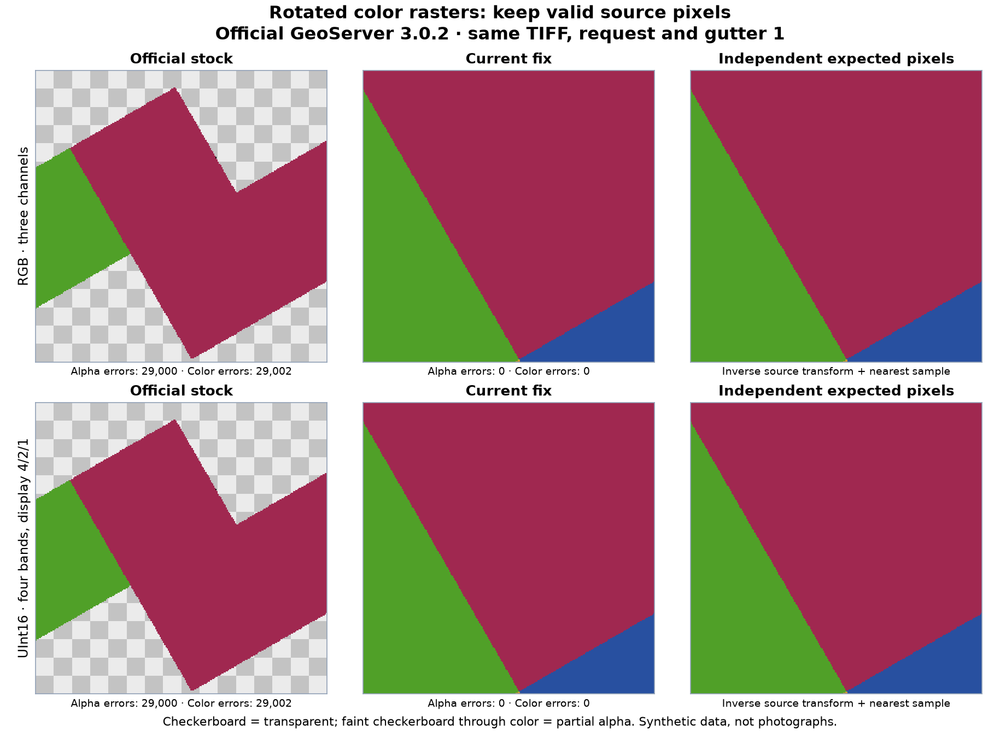
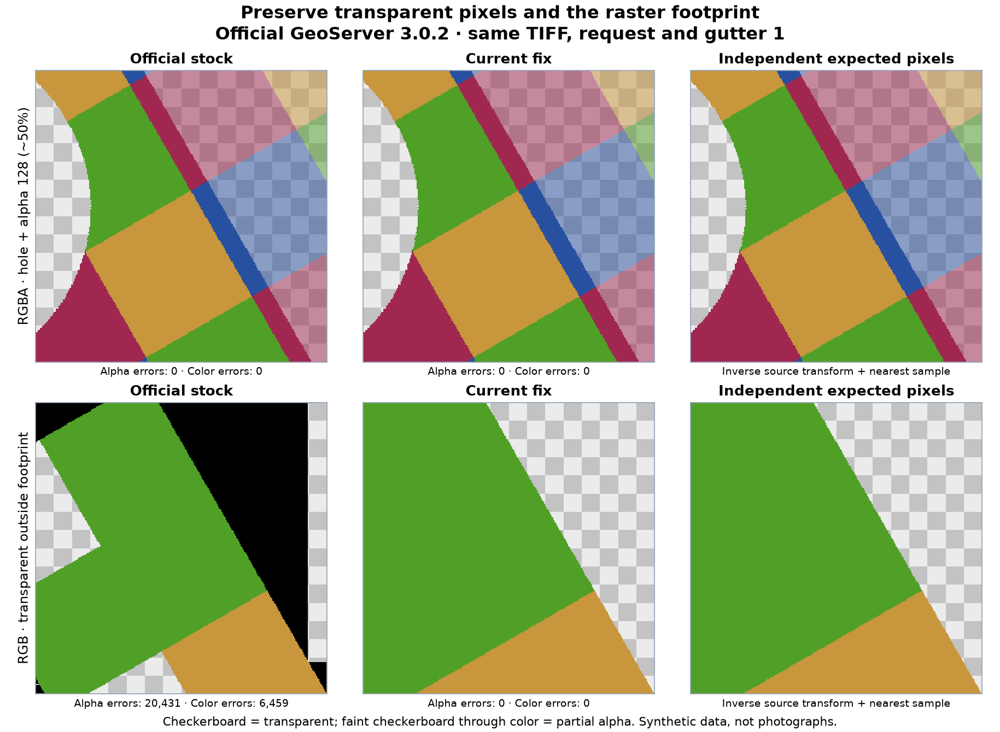
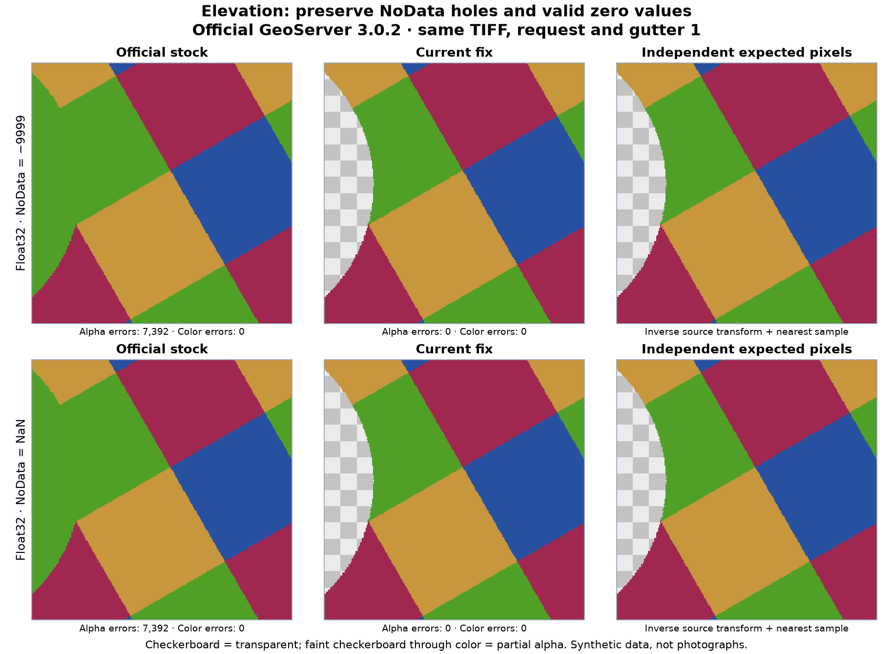

# GeoServer affine-raster fixes

Reproduce and fix missing pixels, footprint-edge errors and transparency handling
when serving rotated or sheared GeoTIFFs with **official GeoServer 3.0.2**.
`main` contains the integrated, optimized candidate for **GeoTools 35.2** and
**Eclipse ImageN 0.9.3**, pinned to the official image in [runtime/lock.json](runtime/lock.json).

This is a project-maintained source fix, **not an accepted upstream change or a
fixed official GeoServer release**. It preserves the source TIFF's transform and
pixels; it does not convert the raster to a north-up image.

## RGB and multiple bands

The stock renderer can discard valid pixels when it crops a rotated source grid
in map coordinates before final rendering. The fix preserves the reader-selected
source window and corrects affine bounds and sample precision.



These are synthetic GeoTIFFs served by two fresh instances of the same official
GeoServer release. Every row uses the same source file, map extent, nearest-neighbor
sampling and gutter 1. The UInt16 example selects bands **4/2/1**; its unused third
band contains unrelated values. The right column is calculated independently
from the original source transform.

## Transparent pixels and the footprint

The source-grid validity mask remains false outside the raster. Native RGBA keeps
its transparent holes and partially transparent pixels. Checkerboard areas below
are intentionally transparent; faint checkerboard through color indicates partial alpha.



The RGBA example contains both alpha 0 and alpha 128 (about 50% opacity). This is
also a preservation check: an already correct transparent area should stay correct.
All selected current-fix panels match the independent oracle within the unchanged
1/255 alpha and 2/255 color tolerances.

## Elevation and NoData

NoData must be classified before rendering substitutes a background value.
Otherwise a hole can become opaque, or valid zero elevation can disappear.
The fix handles numeric and NaN NoData while preserving valid negative and zero values.



Green represents **valid zero elevation** in this synthetic color map. The
checkerboard is NoData. These selected views pass; wider downsampled views have
an additional boundary limitation described below.

The [image evidence](docs/assets/raster-comparisons.json) records request tiles,
fixture/build hashes, measured mismatches and the selection behind each figure.
The figures are composed from actual responses; raw responses remain outside Git.

## Validation and known limits

The established validation on Linux/WSL includes:

- **2,640 current-fix typed image checks:** RGB, native RGBA, four-band UInt16,
  Float32 numeric/NaN NoData, north-up/30° grids, base images/nearest overviews,
  gutters 0/1. Zero missing, spurious, alpha or color mismatches within the stated tolerances.
- **4,720 current-fix grayscale requests:** WMS and GWC, negative rotation,
  15°/30°/45°/75° rotation, shear and north-up. Zero response errors or missing
  pixels at both gutters 0 and 1, including the outer footprint.
- Java regressions cover **32,448 scanlines**, pixel-center bounds, mask borders,
  six sample storage types, packed bits, multi-band validity and range endpoints.
  Python and JavaScript checks also pass.

**Known limit found while making these images:** additional zoomed-out RGBA and
Float32 requests show small alpha/NoData-boundary mismatches at zooms 15–16.
They are outside the earlier typed validity matrix at zooms 20/22/24. The
[validation report](docs/validation.md) preserves these additional observations;
the project does not claim exact output for every resolution.

Arbitrary reprojection, bilinear/bicubic rendering, real ImageMosaic datasets,
other TIFF layouts and native Windows/ARM execution still need validation.
The finite affine scanline precision limit also remains. Source fixtures and
validity tolerances are unchanged. See [full validation and scope](docs/validation.md).

## Performance

The optimized fix is compared with the **previous correctness-validated fix**,
not with an incomplete patch that rendered fewer pixels. The run contains
**62,640 timed requests across three fresh server pairs**.

| Rotated raster | Median paired WMS latency reduction |
|---|---:|
| RGB | 71% |
| RGBA | 65% |
| Four-band UInt16 | 51% |
| Float32 numeric / NaN NoData | 49% |

North-up controls change little. At six clients, WMS throughput rises from about
**72 to 115 requests/second**. Sampled allocation falls from **58.6 to 27.5 MiB/request**.
Cached tile hits bypass rendering and show no consistent mask-processing benefit.

The optimized run has **zero timed response errors**. The comparison baseline
has **one intermittent invalid response**, retained in the results; its cause is
not established. These measurements describe this synthetic workload, not a
production capacity guarantee.

The speedup comes from direct NoData mask writes, direct packed-bit sampling and
omitting a synthetic footprint mask only when the entire request is safely inside
the source image. Edge tiles and existing validity masks retain mask processing.
See [performance results and reproduction](docs/performance.md) and the
[detailed measured report](docs/research/mask-optimized.md).

## Reproduce

Requirements: Python 3.11+, [uv](https://docs.astral.sh/uv/), and Podman.
The grayscale reproduction and image-capture command also support Docker through
`--engine docker`. Rasterio supplies GDAL through its wheel.

```bash
git clone https://github.com/AShapira/geoserver-affine-fix.git
cd geoserver-affine-fix
uv sync --frozen --all-extras
uv run affine-reproduce --pull --root .runs/rendering
uv run python -m affine_fix.typed_suite --root .runs/typed --quality-only
```

Each command creates fresh localhost-only servers with copied synthetic fixtures
and temporary catalogs. The sources and original JARs are checked against the
runtime lock. Generated JARs, credentials, logs and raw responses stay in ignored
run directories. Use a new `--root` each time. The typed runner removes its lab
containers; `affine-reproduce` stops its containers, which can then be removed
with `affine-lab down --root .runs/rendering/stock-lab` and the corresponding
`patched-lab` command.

For reproducible README images, including the additional downsampling checks and
the comparison with the previous candidate, follow [the image workflow](docs/images.md).
For timing and profiling, follow [the performance workflow](docs/research/mask-optimized.md#reproduce).
The [Cesium viewer](viewer/README.md) provides an optional interactive lab.

```bash
uv run python -m unittest discover -s tests -v
node --test viewer/tests/adapter.test.mjs
```

Node 22+ is needed for the viewer tests. GitHub CI runs the lightweight checks;
container rendering, timing and profiling are explicit local runs.

## Code and upstream work

The [GeoTools diff](patches/geotools.patch) preserves the rotated source grid and
its validity mask. The [ImageN diffs](source/README.md) correct exclusive clipping
bounds, zero-outside mask behavior, pixel-center output bounds and affine precision,
and optimize pure nearest-neighbor packed-mask sampling.

The builder replaces or adds only the classes declared in the runtime lock;
unrelated JAR entries retain their bytes and metadata. No custom server image
is built. See [source provenance](source/README.md), [license scope](LICENSING.md)
and the [upstream contribution plan](docs/upstream.md). Upstream-main tests and
maintainer review remain necessary before submission.

[Historical experiments](docs/history/README.md) retain earlier measurements,
including the initial transparency regressions and 16-pixel edge omissions.
Those historical limitations must not be confused with the current tested results.
