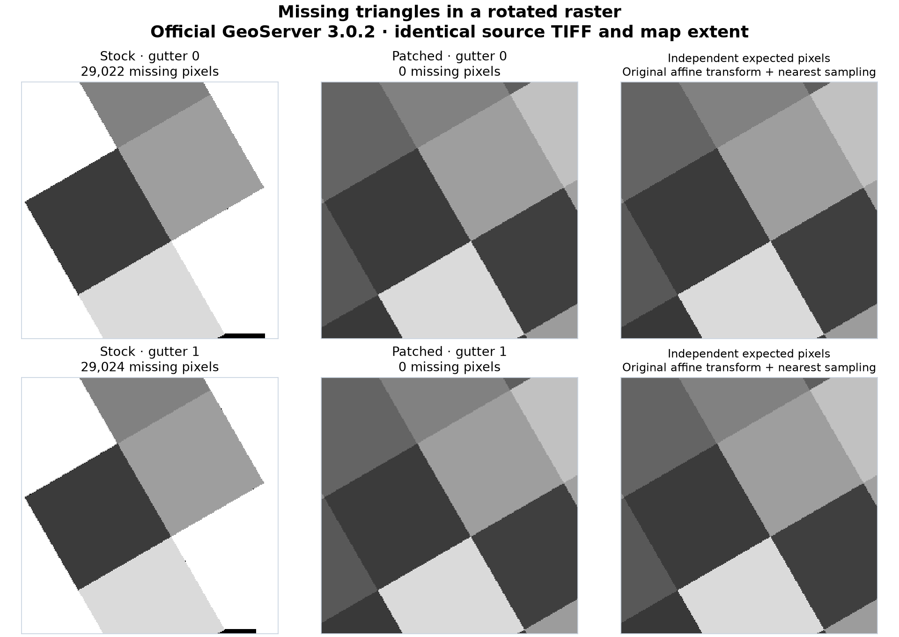
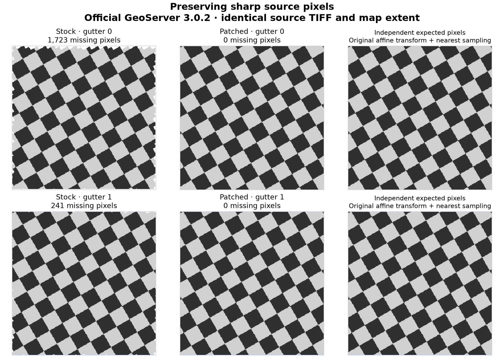
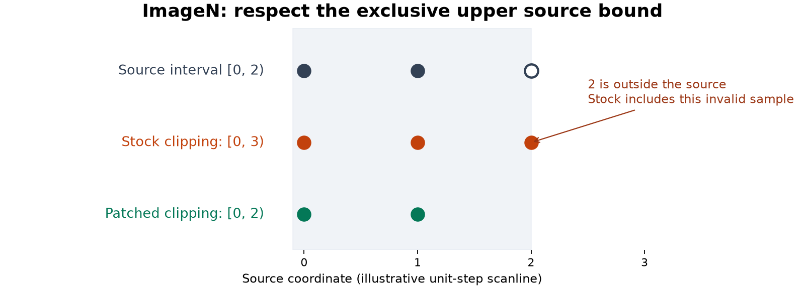

# GeoServer affine-raster fixes

Reproduce two raster-rendering defects on **official GeoServer 3.0.2** and test
candidate source fixes in **GeoTools 35.2** and **Eclipse ImageN 0.9.3**.
GeoServer 3.0.2 is the [current stable release](https://geoserver.org/download/),
verified on 2026-11-03. The test runtime uses the project's
[official container image](https://github.com/geoserver/docker), pinned by digest
in [runtime/lock.json](runtime/lock.json).

These are experimental source corrections, **not an accepted upstream fix**.
The tests preserve the TIFF's rotation/shear, source pixels and nearest-neighbour
sampling. No north-up conversion, smoothing or resampling of the source is used.

## The visible bug

A rotated GeoTIFF contains valid data throughout this map tile, but the stock
server drops triangular areas. White pixels inside this tile are missing output,
not gaps in the source TIFF. Each row compares stock and patched code with the
**same request gutter** and the same map extent. The right column is calculated
independently from the source affine transform.



**GeoTools correction:** `GridCoverageReaderHelper.cropCoverage` crops a rotated
source grid in map coordinates before final rendering. That crop can discard
source pixels that the output still needs. For same-CRS rotated/sheared grids
using nearest interpolation, the candidate change keeps the reader-selected
pixels available to the renderer. See the [source diff](patches/geotools.patch).

The checkerboard example shows that the correction retains sharp source pixels:



## The separate clipping defect

ImageN's affine scanline clipping includes a sample at the exclusive upper source
bound. This can select an invalid sample and cause an array-bounds exception.
The second correction fixes endpoint rounding for both traversal directions and
represents a disjoint intersection as empty. See the [source diff](patches/imagen.patch).



This diagram is an illustration; the two comparisons above contain actual server
responses. A direct Java regression fails against the original ImageN library
and passes against the correction, including **32,448 enumerated scanlines**
with positive, negative, fractional and zero increments.

Across the full matrix, the patch with gutter 1 removed all rendering errors and
missing interior pixels. **Sixteen outer-footprint pixels per route still remain
missing**; this is a separate limitation. See the [measured results](docs/validation.md).

## Reproduce the comparison

Requirements: Python 3.11+ (tested with 3.13), [uv](https://docs.astral.sh/uv/),
and Podman or Docker. The pinned runtime was validated on Linux/WSL amd64.
Rasterio supplies GDAL through its wheel; no host GDAL installation is required.

```bash
git clone https://github.com/AShapira/geoserver-affine-fix.git
cd geoserver-affine-fix
uv sync --frozen --all-extras
uv run affine-reproduce --pull --root .runs/geoserver-3.0.2
```

Use `--engine docker` for Docker. The command generates 14 immutable synthetic
TIFFs, compiles the two corrected classes against the exact official libraries,
and runs stock and patched servers sequentially. Each server gets a fresh
catalog and is tested with gutters **0 and 1**, using direct WMS and GWC/WMTS.
Caches are cleared between treatments and cache MISS responses are verified.

The servers bind to localhost, copy fixtures into their containers and use
temporary catalogs. They do not mount host directories. Generated credentials,
logs, JARs and raw responses remain under the ignored run directory. Both test
servers are stopped when their work finishes. Choose a new `--root` for each run;
existing run directories are not silently reused. `--quick` runs an interior
subset instead of the full matrix, and `--port` selects another localhost port.

The selected rendering regression checks missing interior pixels, source values
and the footprint-edge exception. The [validation report](docs/validation.md)
records the full matrix and remaining limitations. **A gutter is still relevant
at tile boundaries; the code changes alone are not a claim of seamless output.**
For direct WMS the runner expands the request at unchanged resolution and crops
the central tile; for GWC it configures the layer's gutter.

To regenerate the README figures and compact evidence from a completed run:

```bash
uv run affine-report --run .runs/geoserver-3.0.2 --output docs
```

## Work on one server

For an interactive lab and the optional [Cesium gutter viewer](viewer/README.md):

```bash
uv run affine-probe prepare --root .runs/fixtures
uv run affine-lab up --pull --root .runs/lab
uv run affine-validate publish --password-file .runs/lab/admin-password
# Inspect or test the stock server at http://127.0.0.1:18096/geoserver
uv run affine-lab stop --root .runs/lab

uv run affine-build
uv run affine-lab up --root .runs/patched-lab --patch .artifacts/patch
uv run affine-validate publish --password-file .runs/patched-lab/admin-password --output .runs/patched
uv run affine-validate configure --password-file .runs/patched-lab/admin-password --output .runs/patched --gutter 1
uv run affine-validate regression --password-file .runs/patched-lab/admin-password --output .runs/patched --gutter 1
uv run affine-lab stop --root .runs/patched-lab
```

`affine-lab down --root …` removes only that lab's labelled container and keeps
local evidence. The builder verifies source and JAR hashes and changes exactly
one class per JAR. No custom server image is built.

## Tests and contribution status

```bash
uv run python -m unittest discover -s tests -v
node --test viewer/tests/adapter.test.mjs
```

Node 22+ is only needed for the optional viewer and its tests. GitHub CI runs
these lightweight tests; the container rendering matrix is a separate integration
check. [docs/upstream.md](docs/upstream.md) describes the two upstream contribution
paths and the additional current-main tests needed before submission.

Matching source files, patches and license notices are under [source/](source/README.md).
The original tooling is MIT licensed; GeoTools and ImageN code retain their
upstream licenses. See [LICENSING.md](LICENSING.md).
