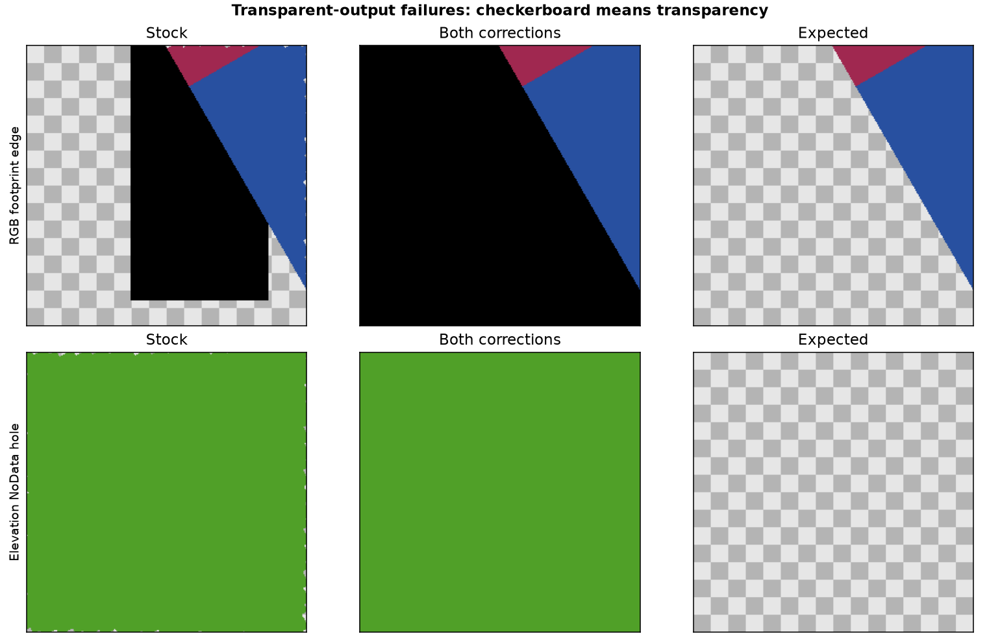

> Historical experiment. For the integrated implementation on this repository’s `main`, see [current validation](../validation.md) and [current performance](../performance.md).

# RGB, alpha, multispectral and elevation tests

**The candidate fix fails broader transparency/NoData validity checks. It is not ready for general deployment.**

Official GeoServer 3.0.2, pinned libraries and freshly built patches. Five data cases × north-up/30° rotation × no overviews/nearest overviews: 20 synthetic 2048² tiled DEFLATE TIFFs. The cases are 8-bit RGB, RGBA, four-band UInt16, Float32 with −9999 NoData, and Float32 with NaN NoData.

RGBA contains transparent borders, an internal hole and alpha 128, stored as non-premultiplied alpha. The generator verifies the alpha tag after reopening each TIFF. UInt16 rendering selects bands 4/2/1 with explicit 0–65535 contrast scaling; band 3 contains unrelated values. Elevation includes valid negative and zero values and an explicit four-color value map. North-up controls use the same data and styles as their rotated counterparts.

## Evidence correction

The initial run incorrectly stored the RGBA fourth band as undefined. Its RGBA results are excluded from **every table and count below**. Those files caused transparent-PNG encoder failures in both variants; that trial is not evidence of a GeoServer RGBA defect. The corrected, alpha-tagged fixtures were rerun through all validity and performance cases with three fresh JVM pairs.

RGB, UInt16 and elevation results come from the initial mixed workload, which also contained the excluded RGBA requests. Correct RGBA results come from a separate RGBA-only workload. Each stock/patched pair uses identical inputs and order, but the workload mix differs between runs. Do not combine their overall throughput, CPU or memory totals. Raw initial results retain the invalid trial for audit; use rgba-results.json for RGBA. The current generator produces the corrected fixtures in a single run.

## Validity

2,640 WMS image checks cover both servers and gutters 0/1. Nearest WMS requests use transparent PNG. The oracle independently inverse-maps output pixel centers to source indices and evaluates the synthetic data and declared style, including footprint, alpha and NoData. There is no erosion of the valid footprint. Color tolerance is 2/255 per channel; alpha tolerance is 1/255. RGB under fully transparent expected pixels is ignored. Zooms 20/22/24 cover interior colors, holes, partial alpha and outer boundaries. The table uses gutter 1 and combines both overview variants. Counts are evaluated output pixels, including overlapping requests, not unique source pixels. Gutter-0 measurements and explicit pass/fail flags are in [validation.json](validation.json).

| Case | Rotation | Variant | Checks | Response errors | Missing valid | Spurious opaque | Alpha mismatches | Color mismatches |
|---|---:|---|---:|---:|---:|---:|---:|---:|
| rgb | 0° | stock | 66 | 0 | 0 | 0 | 0 | 0 |
| rgb | 0° | both | 66 | 0 | 0 | 0 | 0 | 0 |
| rgb | 30° | stock | 66 | 0 | 431,628 | 277,598 | 709,226 | 446,694 |
| rgb | 30° | both | 66 | 0 | 0 | 516,580 | 516,580 | 22 |
| rgba | 0° | stock | 66 | 0 | 0 | 0 | 0 | 0 |
| rgba | 0° | both | 66 | 0 | 0 | 0 | 0 | 0 |
| rgba | 30° | stock | 66 | 0 | 279,950 | 2 | 279,952 | 279,960 |
| rgba | 30° | both | 66 | 0 | 6 | 2 | 8 | 16 |
| multispectral | 0° | stock | 66 | 0 | 0 | 0 | 0 | 0 |
| multispectral | 0° | both | 66 | 0 | 0 | 0 | 0 | 0 |
| multispectral | 30° | stock | 66 | 0 | 431,628 | 277,598 | 709,226 | 446,694 |
| multispectral | 30° | both | 66 | 0 | 0 | 516,580 | 516,580 | 22 |
| dem | 0° | stock | 66 | 0 | 0 | 0 | 0 | 0 |
| dem | 0° | both | 66 | 0 | 0 | 0 | 0 | 0 |
| dem | 30° | stock | 66 | 0 | 267,114 | 1,306,386 | 1,573,500 | 277,486 |
| dem | 30° | both | 66 | 0 | 0 | 1,709,882 | 1,709,882 | 12 |
| dem_nan | 0° | stock | 66 | 0 | 0 | 0 | 0 | 0 |
| dem_nan | 0° | both | 66 | 0 | 0 | 0 | 0 | 0 |
| dem_nan | 30° | stock | 66 | 0 | 267,114 | 1,306,386 | 1,573,500 | 277,486 |
| dem_nan | 30° | both | 66 | 0 | 0 | 1,709,882 | 1,709,882 | 12 |

All five north-up controls pass these gutter-1 checks. The combined fix eliminates the measured missing valid pixels in rotated RGB, UInt16 and elevation, but **increases spurious opacity**. RGB/UInt16 errors are outside the footprint; elevation additionally loses transparency inside NoData holes. Keeping source pixels available must also preserve the masks that hide invalid areas. These results do not isolate which patch causes the regressions.

Correctly tagged RGBA with native channel interpretation improves substantially: missing rotated pixels fall from 279,950 to 6, with 2 spurious opaque pixels, 8 alpha mismatches and 16 color mismatches remaining. This is a large improvement, not an exact validity pass. Small boundary discrepancies are retained in the results.



## Performance

62,640 included timed requests; 0 HTTP/image/cache-state errors. Three fresh JVM pairs, three rounds per pair, 1/6 clients; direct WMS, GWC MISS and GWC HIT. Two WMS warmup passes per server. Caches are cleared for MISS and primed for HIT; every timed cache header is checked. Requests use paired shuffled order. Validity decoding is outside timing. Direct WMS timing uses opaque output (the existing benchmark contract); transparent validity is tested separately. Each server has two CPU cores of quota and a 2 GiB maximum heap. Only one server receives benchmark load at a time.

**These timings include incorrect images. A speedup in a failing case does not establish a valid optimization.**

Single-client direct-WMS medians combine base/overview fixture medians across rounds within each JVM, then take the median across three JVMs. The per-JVM range is not a confidence interval. All routes and client counts are available in [the per-fixture latency table](performance.csv), including p95, errors, JVM and round.

| Case | Rotation | Stock ms | Both fixes ms | Stock JVM range | Fixed JVM range |
|---|---:|---:|---:|---:|---:|
| rgb | 0° | 5.50 | 5.17 | 5.33–5.67 | 5.16–5.34 |
| rgb | 30° | 10.03 | 5.71 | 9.43–10.23 | 5.19–6.13 |
| rgba | 0° | 9.21 | 8.39 | 8.00–9.45 | 8.13–9.57 |
| rgba | 30° | 12.79 | 8.82 | 10.97–13.73 | 8.62–9.65 |
| multispectral | 0° | 22.17 | 23.30 | 21.41–24.61 | 22.37–24.70 |
| multispectral | 30° | 46.56 | 23.73 | 45.52–50.63 | 21.88–23.87 |
| dem | 0° | 13.10 | 12.15 | 12.29–14.38 | 11.91–13.95 |
| dem | 30° | 18.73 | 13.53 | 18.11–19.38 | 12.63–14.25 |
| dem_nan | 0° | 13.03 | 13.66 | 12.63–13.88 | 12.11–13.70 |
| dem_nan | 30° | 18.91 | 13.66 | 17.82–19.76 | 12.61–13.81 |

The intended speed benefit is less intermediate crop/mask processing before affine rendering. These measurements are consistent with that explanation, but do not isolate the time saved by each operation. In the new failing cases, skipped transparency work is also a correctness loss. Differences in north-up controls should be treated as run variability unless a further controlled experiment establishes a repeatable effect.

## RGBA style and encoder checks

An additional 1,056 image checks compare PNG and PNG8, native RGBA interpretation and explicit RGB channel selection. All responses encode successfully with properly tagged fixtures. PNG and PNG8 give identical mismatch counts in this small synthetic palette. Native RGBA preserves the tested alpha values in the north-up control. Explicit RGB channel selection drops alpha even in the stock north-up control: it is not an equivalent style for testing preservation of the source alpha. The main RGBA table therefore uses native interpretation. This style-dependent behavior is separate from the patch regression. [All diagnostic rows](rgba-diagnostic.json).

## Reproduce

```bash
uv run python -m affine_fix.typed_suite --root .runs/typed-3.0.2
uv run python -m affine_fix.typed_report --run .runs/typed-3.0.2
uv run python -m affine_fix.typed_figures --run .runs/typed-3.0.2
```

For the two-run evidence published here, the report additionally uses `--rgba-run .runs/typed-rgba-3.0.2 --rgba-diagnostic .runs/rgba-encoder-check`. Run an RGBA-only matrix with `--kinds rgba`; run the style/encoder diagnostic with `uv run python -m affine_fix.rgba_diagnostic --run RUN --root NEW_DIRECTORY`.

[Initial measurements and fixture hashes](results.json) · [Initial timed samples](requests.jsonl.gz)
[Corrected RGBA measurements](rgba-results.json) · [Corrected RGBA timed samples](rgba-requests.jsonl.gz)

The runner builds against the pinned official image and removes only its labelled test containers. Source TIFF hashes are checked at completion. Credentials, source TIFFs and response PNGs stay in ignored run directories. The standard grayscale catalog bootstrap does not enter these typed measurements.

Scope limits: synthetic fixtures, one CRS, nearest interpolation, two orientations, one machine. This does not certify other styles, reprojection, all compression/interleave layouts, or all numeric types. GWC timing checks PNG headers, dimensions and cache state; it does not decode every timed image or apply a separate per-pixel WMTS oracle. The two corrections were tested together; attribution to one correction requires an isolation run.
